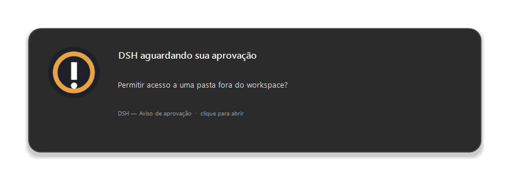

# DSH — Aviso de aprovação

[](https://github.com/pedromarcioap/dsh-approval-notifier/actions/workflows/test.yml)
[](LICENSE)

Extensão do Chrome (Manifest V3) que mostra uma **notificação nativa** — no
Windows, um toast do sistema — quando o DeepSeek Harness está bloqueado
esperando uma decisão sua na conversa.



> Imagem ilustrativa (`tools/make-preview.ps1`). O visual real segue o tema do
> seu Windows.

## Quando dispara

A extensão observa os painéis que assumem o compositor do chat. Cada um publica
um atributo estável, então nada depende de classes CSS geradas:

| Painel | Marcador observado | Notificação |
|---|---|---|
| Aprovação de ferramenta / escalação de sandbox | `[data-approval-key]` | “DSH aguardando sua aprovação” |
| Pergunta do `ask_user_question` | `[data-question-key]` | “DSH aguardando sua resposta” |
| Revisão de plano (plan mode) | `[data-plan-review-key]` | “DSH aguardando revisão do plano” |

Comportamento:

- **Uma notificação por pedido.** Mutações repetidas do DOM não duplicam o aviso.
- **Fecha sozinha** quando você responde, ou quando o painel sai da tela.
- **Bipe curto** junto com o toast, liberado só depois de um gesto seu na página
  (exigência de autoplay do Chrome).
- **Título da aba** ganha um `⚠ ` enquanto houver algo pendente.
- Clicar na notificação **foca a aba** do DSH.

## Instalação

1. Abra `chrome://extensions`.
2. Ative o **Modo do desenvolvedor**.
3. Clique em **Carregar sem compactação** e selecione a pasta da extensão.
4. **Recarregue a aba do DSH** (`F5`) — o content script só entra em páginas
   carregadas depois da instalação.
5. Clique no ícone da extensão e use **Enviar notificação de teste**.

Há uma release com `.zip` pronto em
[Releases](https://github.com/pedromarcioap/dsh-approval-notifier/releases) —
basta descompactar e carregar a pasta.

> A extensão fica instalada enquanto a pasta existir. Se mover ou apagar a
> pasta, remova e carregue de novo.

## Configuração (popup)

- **Ativar avisos** — liga/desliga sem remover a extensão.
- **Só quando a janela não estiver em foco** — evita o aviso redundante quando
  você já está olhando o chat. Se um pedido chegar com a janela em foco, ele
  ainda avisa no momento em que você troca de janela.

## Se a notificação não aparecer

1. `chrome://settings/content/notifications` → libere o site `127.0.0.1:3080`
   (ou o Chrome inteiro).
2. Windows → Configurações → Sistema → Notificações: permita o Chrome e
   desative o **Assistente de Foco** durante o horário de trabalho.
3. Confirme que a porta no `manifest.json` bate com a do harness (hoje `3080`).
4. Se um aviso laranja aparecer no canto da página dizendo **Aviso de aprovação
   inativo**, a extensão foi recarregada depois da página: aperte `F5`.
   O popup também mostra há quanto tempo foi o último aviso e se há alguma aba
   conversando com a extensão.

## Limitações

- **Precisa da aba aberta.** A extensão observa o DOM; com o navegador fechado
  não há aviso (também não haveria onde responder).
- **Só a página do DSH.** Não interfere em outras abas nem em outros sites.
- **Não é um canal de aprovação.** Ela avisa; a decisão continua no painel do
  chat, e cada aprovação vale uma única vez.

## Desenvolvimento

```powershell
node test/content.test.mjs          # 23 verificações, DOM + chrome simulados
pwsh -File tools/build-release.ps1  # gera dist/dsh-approval-notifier-<versão>.zip
```

O workflow [`.github/workflows/test.yml`](.github/workflows/test.yml) roda esses
testes a cada push e pull request.

## Licença

MIT — veja [LICENSE](LICENSE).

---

# DSH — Approval notifier

Chrome extension (Manifest V3) that fires a **native notification** — a Windows
toast on Windows — whenever DeepSeek Harness is blocked waiting for your
decision in the conversation.

## When it fires

It watches the panels that take over the chat composer. Each one publishes a
stable attribute, so nothing depends on generated CSS classes:

| Panel | Observed marker | Notification |
|---|---|---|
| Tool approval / sandbox escalation | `[data-approval-key]` | “DSH aguardando sua aprovação” |
| `ask_user_question` prompt | `[data-question-key]` | “DSH aguardando sua resposta” |
| Plan review (plan mode) | `[data-plan-review-key]` | “DSH aguardando revisão do plano” |

- **One notification per request**, no duplicates on repeated DOM mutations.
- **Auto-clears** when you answer or the panel leaves the screen.
- **Short beep**, only after a user gesture on the page (Chrome autoplay rule).
- **Tab title** gets a `⚠ ` prefix while something is pending.
- Clicking the notification **focuses the DSH tab**.

## Install

1. Open `chrome://extensions`.
2. Enable **Developer mode**.
3. Click **Load unpacked** and select the extension folder.
4. **Reload the DSH tab** (`F5`).
5. Open the popup and press **Enviar notificação de teste**.

A packaged `.zip` is available under
[Releases](https://github.com/pedromarcioap/dsh-approval-notifier/releases).

## Troubleshooting

If an orange banner shows **Aviso de aprovação inativo**, the extension was
reloaded after the page: press F5. The popup also reports how long ago the
last notification happened and whether any tab is talking to the extension.

## Settings (popup)

- **Ativar avisos** — on/off without removing the extension.
- **Só quando a janela não estiver em foco** — stay quiet while you are already
  looking at the chat; still alerts the moment you switch away.

## Known limitations

- **Needs the tab open.** It observes the DOM; with the browser closed there is
  nothing to alert (and nowhere to answer either).
- **DSH page only.** It does not touch other tabs or sites.
- **Not an approval channel.** It only notifies; the decision still happens in
  the chat panel, and every approval is one-shot.

## License

MIT — see [LICENSE](LICENSE).
